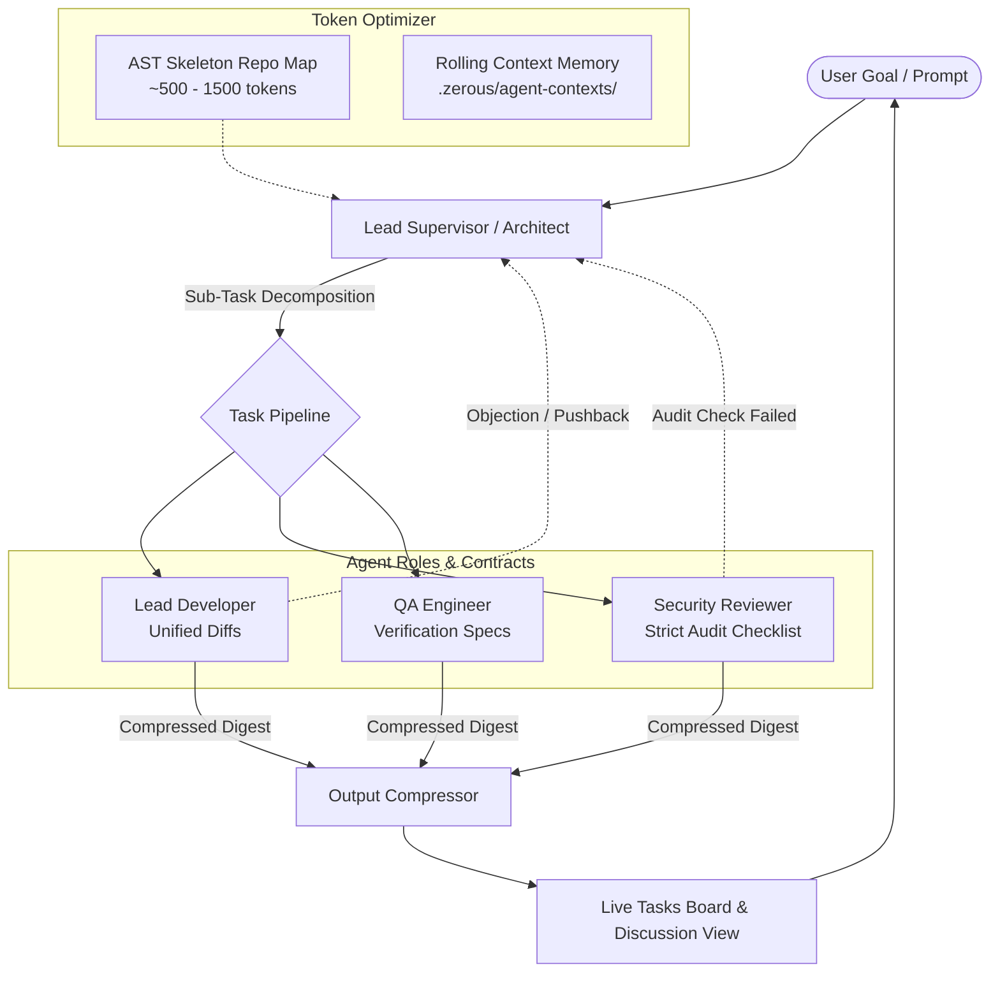

<div align="center">


# Zerous

**The AI-Native Multi-Agent Coding Workspace**

*Empowering developers with autonomous agent swarms, role-driven contract enforcement, and token-efficient architectural orchestration.*

[](https://opensource.org/licenses/MIT)
[](https://www.electronjs.org/)
[](https://react.dev/)
[](https://www.typescriptlang.org/)
[](https://vitejs.dev/)
[]()

[Features](#key-features) • [Architecture](#architecture--token-optimization) • [Quick Start](#quick-start) • [Role System](#multi-agent-role-contracts) • [Building](#building-for-production)

</div>

---

## ⚡ Overview

**Zerous** is a next-generation desktop coding workspace designed from the ground up for **Multi-Agent Collaboration**. Unlike traditional editors that merely plug a chat window into the sidebar, Zerous treats AI agents as first-class team members coordinated by an autonomous **Supervisor Leader**.

Zerous integrates deep architectural mapping, token-conserving contract negotiation, live terminal emulation, Monaco code editing, and integrated Git source control into a sleek, zero-distraction dark workspace.

---

## ✨ Key Features

### 🧠 Autonomous Multi-Agent Orchestration (Supervisor & Swarm)
- **High-Level Decomposition**: The Supervisor analyzes user instructions against a lightweight codebase outline, breaking complex features into sequential sub-tasks.
- **Pre-Flight Role Validation & Contract Negotiation**: Specialized agents (Lead Developer, Security Auditor, QA Engineer) evaluate tasks against strict internal rulebooks. If instructions violate contracts (e.g. security flaws, missing schemas), agents negotiate and raise objections before code execution.
- **Dynamic Task Dispatching**: Live tracking of deliverables, running states, and status badges in a dedicated right-panel Task board.

### 🍃 Token-Saver & Memory Optimizer Engine
- **AST Architecture Mapping**: Automatically extracts TypeScript, JavaScript, Python, Go, and Rust interface/type/function skeletons without dumping raw function bodies (~80-90% token reduction).
- **Concise Unified Diff Protocol**: Enforces diff-based patches (`--- a/file +++ b/file`) instead of reprinting 500-line full files.
- **Rolling Context Compaction**: Employs rolling memory buffers to prevent context degradation and memory bloat over prolonged discussion sessions.

### 🖥️ Native Engineering Workspace
- **Zero-Border Modern Dark Theme**: Tailored ergonomics crafted with `#121316` and `#16181f` palettes, optimized for extended coding marathons.
- **Integrated Full PTY Terminal**: Ultra-responsive native shell sessions (`node-pty` + `@xterm/xterm`) bounded within project tabs.
- **Monaco Code Editor**: Professional syntax highlighting, multi-cursor editing, and code navigation powered by the VS Code editor core.
- **Dual-Pane Rightbar with Bottom Controls**: Instant switching between the **File Explorer** and **Tasks List** via a seamless 32px bottom status bar.
- **Visual Git Suite**: Integrated branch switcher, uncommitted diff reviewer, sync buttons, and commit history.

---

## 🏛️ Architecture & Token Optimization



---

## 🚀 Quick Start

### Prerequisites
- **Node.js**: `>= 18.0.0`
- **npm**: `>= 9.0.0`
- **Linux / macOS / Windows**

### Installation

Clone the repository and run the automated installer:

```bash
git clone https://github.com/antoine-mai/ide.git
cd ide

# Install dependencies, build native node-pty & register desktop icon
./scripts/install.sh
```

### Verification & Local Test

To perform an end-to-end build verification without automatically launching:

```bash
./scripts/install-test.sh
```

### Running in Development

```bash
npm run dev
# or launch Electron directly
./node_modules/electron/dist/electron .
```

---

## 🛠️ Multi-Agent Role Contracts

Zerous features granular role definitions configurable via the **Roles & Supervisor** settings dialog:

| Role | Focus Scope | Contract Guidelines |
| :--- | :--- | :--- |
| **Supervisor (Leader)** | Architectural planning & synthesis | Decomposes goals, reads AST skeletons only, merges deliverables. |
| **Lead Developer** | Implementation & Refactoring | Produces minimal Unified Diffs, exact line-numbered edits, zero filler code. |
| **Security Reviewer** | Security Audit & Compliance | Enforces OWASP standards, checks for plain credentials, prevents SQLi & XSS. |
| **QA Engineer** | Edge-case verification | Formulates test matrices, verifies UI interactions and schema integrity. |

---

## 📦 Building for Production

Build standalone binaries and distribution packages using the included production script:

```bash
# Package for Linux (AppImage, deb, tar.gz)
./scripts/build.sh

# Or target specific packaging platforms
./scripts/build.sh --linux AppImage
./scripts/build.sh --linux dir
```

Outputs will be generated in `release/`:
- `release/linux-unpacked/ide`: Portable unpacked binary
- `release/Zerous-0.1.0.AppImage`: Self-contained Linux executable

---

## 📂 Project Directory Structure

```text
ide/
├── build/                # High-resolution icons (SVG, PNG, ICO)
├── electron/             # Electron main process & IPC handlers
│   ├── main.ts           # Window lifecycle & native bindings
│   ├── orchestrator.ts   # LangGraph multi-agent orchestration
│   ├── context-optimizer.ts # AST skeleton extractor & repo map cache
│   └── preload.ts        # Secure contextBridge preload APIs
├── public/               # Public assets & SVG branding
├── scripts/
│   ├── install.sh        # Automated dependencies & native module setup
│   ├── install-test.sh   # Build check & verification suite
│   ├── install-desktop-icon.sh # OS Desktop entry & icon installer
│   └── build.sh          # Production builder
├── src/                  # React 19 Frontend application
│   ├── components/
│   │   ├── DiscussionView.tsx  # Centralized multi-agent chat view
│   │   ├── TasksListView.tsx   # Rightbar task management panel
│   │   ├── TreeBrowser.tsx     # File explorer with VS Code context menu
│   │   ├── TerminalTab.tsx     # Interactive xterm terminal tabs
│   │   └── GitModal.tsx        # Visual source control & diff viewer
│   ├── App.tsx           # Main workspace shell & layout state
│   └── index.css         # Dark ergonomic stylesheet
├── electron-builder.json # Packaging & distribution specification
└── package.json
```

---

## 🤝 Contributing

Contributions are welcomed! Feel free to submit Issues or Pull Requests.

1. Fork the Project
2. Create your Feature Branch (`git checkout -b feature/AmazingFeature`)
3. Commit your Changes (`git commit -m 'Add some AmazingFeature'`)
4. Push to the Branch (`git push origin feature/AmazingFeature`)
5. Open a Pull Request

---

## 📄 License

Distributed under the **MIT License**. See `LICENSE` for more information.

<div align="center">
<sub>Crafted with precision for AI engineers and autonomous development workflows.</sub>
</div>
